  

  <b>Cyber-physical systems engineer</b> focused on testing and validating sensor-to-actuator loops. 
  Robots, simulators, drones and driver-monitoring: different machines, same question,
  <i>is the system measuring and behaving the way we think it is?</i>

---

## The question behind my work

> **Where does the delay come from, and how wrong is the measurement?**

I build small, repeatable experiments that answer it against **ground truth**, then publish the numbers
with their caveats. If a result is a single run in simulation, the README says so.

  

## Projects

| | Project | What it answers | Built with |
|---|---|---|---|
| 🎯 | [**ChromaPick**](https://github.com/AbhishekDubasi09/Franka_Panda_Color_Sorting_Robot) | Can geometry replace hand-tuned constants in a colour sorter? 1.1 mm vs 89.6 mm in simulation | ROS 2, MoveIt 2, Gazebo, OpenCV |
| 🛰️ | [**When the Setpoints Stop**](https://github.com/AbhishekDubasi09/px4-offboard-timing-study) | What does a late or paused command stream do to PX4 offboard flight? | ROS 2, PX4 SITL, Gazebo |
| 🚗 | [**Is the Driver Monitor Right?**](https://github.com/AbhishekDubasi09/driver-monitoring-validation) | How accurate is camera-based driver monitoring, and where does its timing error come from? | Unity, MediaPipe, OpenCV, Python |
| 🏭 | [**Cool Under Load**](https://github.com/AbhishekDubasi09/aas-digital-twin) | Can a digital twin keep a pick-and-place arm out of its thermal trip? | OPC UA, MQTT, AAS, ROS 2 |
| 📈 | [**Trust Your Sensors**](https://github.com/AbhishekDubasi09/sensor-data-quality-checks) | Which logged samples can you believe? Flags them, never deletes them | Python, pandas, NumPy, CI |
| 🥽 | [**VehicleSafetySim 2026**](https://github.com/AbhishekDubasi09/VehicleSafetySim_2026) | How do drivers react in Euro NCAP-style AEB pedestrian conflicts? | Unity 6, OpenXR, Meta Quest 3 |

## Toolbox

`Python` · `C#` · `C/C++ (learning, embedded)` · `ROS 2` · `Gazebo` · `MoveIt 2` · `PX4` · `MuJoCo` · `Unity`
`OpenCV` · `MediaPipe` · `OPC UA` · `MQTT` · `Git + CI` · `ESP32` · `Arduino` · `CATIA` · `Siemens NX`

## Now

- 🔬 Planning a measurement study: **how late is an ESP32 loop?** A logic analyser as ground truth,
  delay distributions with confidence intervals, compared with a simulation. Not started yet.
- 📚 Looking at **world action models** in robotics, and whether their latency and imagined futures
  can be tested the way I test everything else.
- 🧪 Getting stronger at embedded C/C++.

## Ground rules I work by

- A number needs a source file next to it.
- "Evaluation" is not "benchmark". I say how small the sample is.
- If I build on someone's open-source project, the credit is the first thing in the README.

Say hello via the issues of any repo above.

